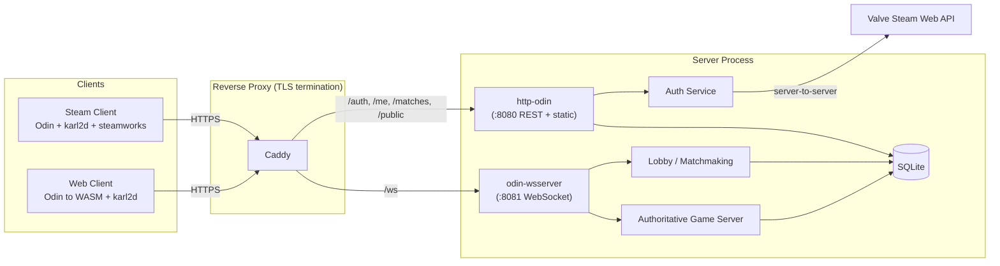
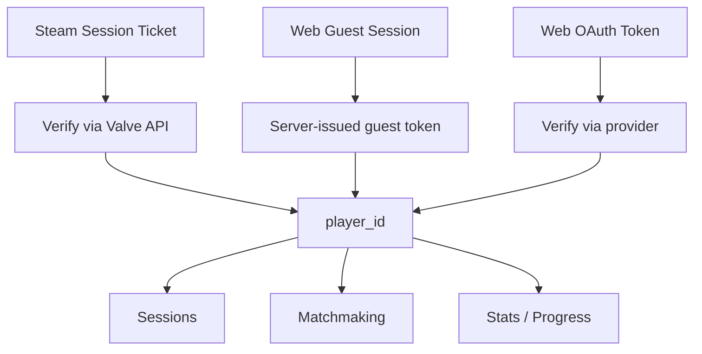
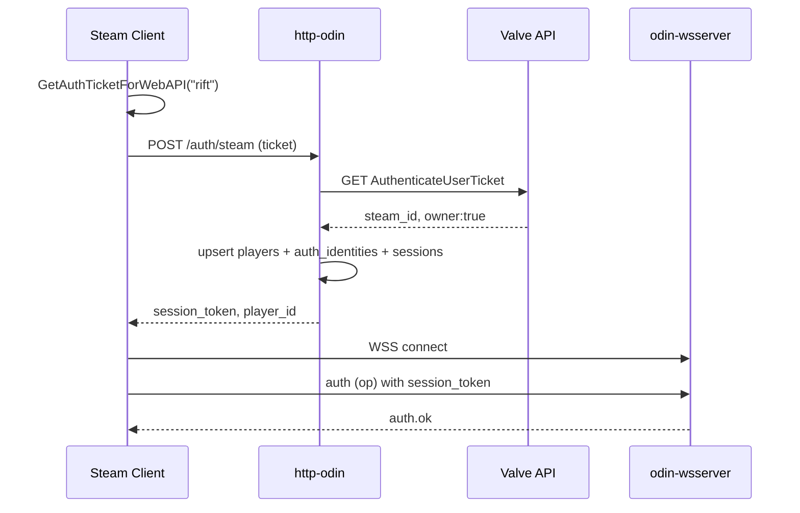
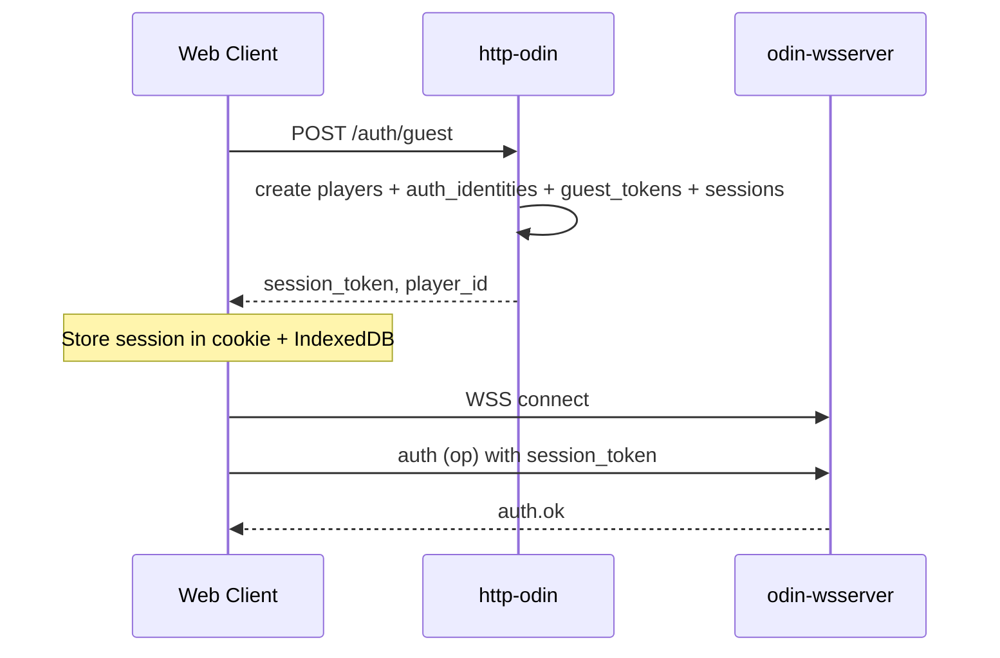
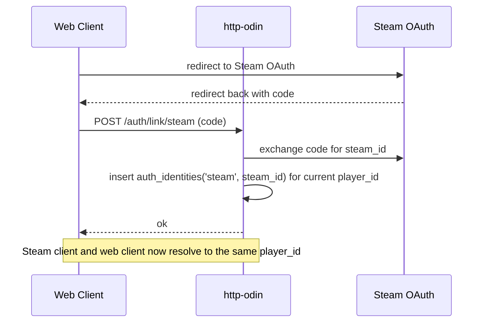

# RIFT — Network Architecture

**Stack:** Odin + karl2d (client) · http-odin (server) · odin-steamworks (Steam) · saenai255/odin-wsserver (WebSocket) · WASM (web client) · SQLite (persistence)

---

## 1. High-Level Topology

`http-odin` and `odin-wsserver` are separate server implementations that each bind their own socket. They run in the same process (or process group) but on two distinct internal ports, fronted by a reverse proxy that terminates TLS and routes traffic.



**Principles**
- Two listeners behind one reverse proxy. `http-odin` and `odin-wsserver` never share a port.
- Server is **authoritative** for all game state; clients send intents only.
- Identity is **platform-agnostic**: every session resolves to one `player_id`.
- Steam session tickets and web auth are **authentication methods**, not game identities.
- `wsServer` runs each client connection on its own OS thread; see §7 Concurrency Model.

---

## 2. Identity Model



- `player_id` is the **only** ID the game logic sees.
- One `player_id` can have multiple **auth methods** (Steam ID, guest token, OAuth provider ID).
- Auth methods are stored in `auth_identities`; the mapping to `player_id` is what enables account linking.

---

## 3. SQLite Schema

```sql
-- Players: one row per game identity
CREATE TABLE players (
    player_id       INTEGER PRIMARY KEY AUTOINCREMENT,
    display_name    TEXT NOT NULL,
    created_at      INTEGER NOT NULL, -- unix ts
    last_seen_at    INTEGER NOT NULL
);

-- Auth methods linked to a player (Steam, guest, OAuth)
CREATE TABLE auth_identities (
    identity_id     INTEGER PRIMARY KEY AUTOINCREMENT,
    player_id       INTEGER NOT NULL REFERENCES players(player_id),
    provider        TEXT NOT NULL,   -- 'steam' | 'guest' | 'google' | 'discord'
    provider_uid    TEXT NOT NULL,   -- steam_id / guest_uuid / oauth_sub
    created_at      INTEGER NOT NULL,
    UNIQUE(provider, provider_uid)
);
CREATE INDEX idx_auth_player ON auth_identities(player_id);

-- Guest tokens (short-lived, first-visit)
CREATE TABLE guest_tokens (
    token           TEXT PRIMARY KEY,  -- random 32+ bytes hex
    player_id       INTEGER NOT NULL REFERENCES players(player_id),
    expires_at      INTEGER NOT NULL,
    created_at      INTEGER NOT NULL
);

-- Session tokens issued after successful auth
CREATE TABLE sessions (
    session_token   TEXT PRIMARY KEY,  -- opaque random
    player_id       INTEGER NOT NULL REFERENCES players(player_id),
    platform        TEXT NOT NULL,     -- 'steam' | 'web'
    expires_at      INTEGER NOT NULL,
    created_at      INTEGER NOT NULL
);
CREATE INDEX idx_sessions_player ON sessions(player_id);

-- Match records
CREATE TABLE matches (
    match_id        INTEGER PRIMARY KEY AUTOINCREMENT,
    started_at      INTEGER NOT NULL,
    ended_at        INTEGER,
    winner_player   INTEGER REFERENCES players(player_id),
    seed            INTEGER NOT NULL,  -- RNG seed for deterministic replay
    state_blob      BLOB              -- optional: final state snapshot
);

-- Match participants (also stores final VP breakdown)
CREATE TABLE match_players (
    match_id        INTEGER NOT NULL REFERENCES matches(match_id),
    player_id       INTEGER NOT NULL REFERENCES players(player_id),
    faction         TEXT NOT NULL,     -- 'swarm'|'corp'|'ai'|'nomad'
    public_vp       INTEGER NOT NULL DEFAULT 0,
    faction_vp      INTEGER NOT NULL DEFAULT 0,
    directive_vp    INTEGER NOT NULL DEFAULT 0,
    total_vp        INTEGER NOT NULL DEFAULT 0,
    PRIMARY KEY (match_id, player_id)
);

-- Progress / stats (per player, cross-platform)
CREATE TABLE player_stats (
    player_id       INTEGER PRIMARY KEY REFERENCES players(player_id),
    games_played    INTEGER NOT NULL DEFAULT 0,
    wins            INTEGER NOT NULL DEFAULT 0,
    -- faction-specific counters can be columns or a JSON blob
    faction_stats   TEXT NOT NULL DEFAULT '{}'
);
```

**Notes**
- Enable `PRAGMA journal_mode=WAL;` and `PRAGMA foreign_keys=ON;`.
- One SQLite file per environment; back up via file copy or `.backup` command.
- Store timestamps as unix seconds (INTEGER) for portability.
- SQLite is a single-writer engine. See §7 Concurrency Model for how this is enforced.

---

## 4. Authentication Flows

### 4.1 Steam client



- Server never trusts the client's Steam ID; only Valve's API response.
- Ticket is single-use; do not cache across reconnects.

### 4.2 Web client — guest



### 4.3 Web client — account linking (guest to Steam)



- Reject link if the Steam ID is already linked to another `player_id` (or offer merge flow later).
- Guest identity remains linked; the player can log in from either platform.

---

## 5. Wire Protocol

### 5.1 HTTP endpoints (http-odin)

| Method | Path | Auth | Purpose |
|---|---|---|---|
| `POST` | `/auth/steam` | Steam ticket | Exchange ticket for session |
| `POST` | `/auth/guest` | none | Create guest player + session |
| `POST` | `/auth/link/steam` | session | Link Steam to current player |
| `POST` | `/auth/logout` | session | Invalidate session |
| `GET`  | `/me` | session | Player profile + stats |
| `GET`  | `/matches/recent` | session | Recent matches |
| `GET`  | `/health` | none | Liveness probe |

All JSON. Auth via `Authorization: Bearer <session_token>` header.

### 5.2 WebSocket (game + lobby)

- URL: `wss://host/ws` (proxy forwards to `odin-wsserver` on `:8081`)
- **Auth is mandatory as the first message.** The client MUST send `{ "op": "auth", "token": "<session_token>" }` immediately after the connection opens.
- The server rejects any other `op` received before successful authentication, and closes the connection if no valid `auth` message arrives within **5 seconds**.
- Do **not** rely on the `Authorization` header for WebSocket auth: `odin-wsserver` does not expose handshake headers to callbacks, and browser clients cannot set custom headers on WebSocket upgrade.
- Transport: JSON messages (upgrade to binary only if profiling demands it).

#### Common envelope
```json
{ "op": "string", "seq": 12, "ts": 1712345678, "data": { } }
```

#### Client to Server ops
| `op` | `data` | When |
|---|---|---|
| `auth` | `{ token }` | **Mandatory first message** |
| `lobby.join` | `{ }` | Enter lobby queue |
| `lobby.leave` | `{ }` | Leave queue |
| `match.create` | `{ max_players }` | Create private match |
| `match.join` | `{ match_id }` | Join private match |
| `match.ready` | `{ ready: bool }` | Ready to start |
| `game.action` | `{ round, ap_spent, action, target... }` | Your turn, one per action |
| `game.end_turn` | `{ }` | End turn |
| `game.forfeit` | `{ }` | Concede |
| `chat` | `{ text }` | In-match chat |

#### Server to Client ops
| `op` | `data` | When |
|---|---|---|
| `auth.ok` | `{ player_id, display_name }` | After auth |
| `auth.err` | `{ reason }` | Auth failed; connection closes |
| `lobby.update` | `{ players: [...] }` | Queue state change |
| `match.start` | `{ match_id, seed, factions, start_hexes }` | Match begins |
| `match.state` | `{ round, turn_player, public_state }` | After every accepted action |
| `game.action_ok` | `{ seq }` | Ack |
| `game.action_err` | `{ seq, reason }` | Reject |
| `game.hidden` | `{ hand, secret_directives }` | Private, only to that player |
| `game.reveal` | `{ combat, cards }` | Combat reveal broadcast |
| `match.end` | `{ winner, vp_breakdown }` | End of game |
| `error` | `{ code, message }` | Generic error |

**Rules**
- Server is authoritative. `game.action` is validated against RIFT rules before mutation.
- `match.state` is **public** state only; hidden info (hands, secret directives) is sent via `game.hidden` per recipient.
- `seq` is monotonic per client; server acks and rejects with the same `seq`.
- All randomness comes from the server's `seed` (deterministic, enables replay for anti-cheat).
- Connections that do not authenticate within 5 seconds are closed.

---

## 6. Client Responsibilities

### Steam client (Odin + karl2d + odin-steamworks)
- On boot: `SteamAPI.Init()`, then `ISteamUser.GetAuthTicketForWebAPI`.
- POST `/auth/steam`, store session token.
- Connect WebSocket, send `auth` first message, wait for `auth.ok`, then `lobby.join`.
- Render local state; send only intents (`game.action`) on player input.
- On reconnect: if token is expired, re-run `/auth/steam`; then open WS, send `auth`, request current `match.state`.

### Web client (Odin to WASM + karl2d)
- On first visit: `POST /auth/guest`, store session in IndexedDB and cookie.
- Same WS flow as Steam client: connect, send `auth` first, then `lobby.join`.
- "Link Steam" button on profile page performs OAuth redirect, then `POST /auth/link/steam`.
- WASM size: keep dependencies minimal; load assets in parallel; show explicit loading screen.

### Both
- **Never** simulate authoritative game state; render the last `match.state` and animate transitions.
- Input lockout: disable actions when `turn_player != player_id` (server rejects anyway).
- Predict nothing that can desync; prediction allowed only for cosmetics (animations).
- Treat `odin-wsserver` as a stateful socket: handle disconnect and reconnect explicitly.

---

## 7. Server Responsibilities

### Modules
| Module | Transport | Role |
|---|---|---|
| `auth` | http-odin | Steam, guest, OAuth verification; session issuing; account linking |
| `db` | shared | SQLite access; serialised writes via single writer |
| `valve` | http-odin | Steam Web API client (server-to-server HTTPS) |
| `ws` | odin-wsserver | Connection lifecycle, per-connection state, `auth` gating |
| `lobby` | odin-wsserver | Queue, private matches, ready checks |
| `game` | odin-wsserver | RIFT rules engine, one instance per match |

### Per-match game instance
- Holds in-memory authoritative state (RIFT rules engine).
- Tickless: state mutates only on `game.action` and `game.end_turn`.
- Emits `match.state` (public) plus `game.hidden` (per-player) after each accepted action.
- On match end: writes `matches`, `match_players`, updates `player_stats`, emits `match.end`.
- Enforces turn order, AP, action legality, resource caps, combat math, identical to the board game rules.

### Concurrency Model (locked)

`odin-wsserver` runs **each client connection on its own OS thread**. `http-odin` runs its own request handlers. This has two hard consequences:

1. **SQLite writes MUST be serialised.**
   - Route every write (`INSERT`, `UPDATE`, `DELETE`, DDL) through a **single writer thread** fed by an MPSC channel, or guard every write with a global mutex.
   - Reads may be concurrent under WAL mode, but only if using separate read-only connections.
   - Never call `sqlite3_exec` or equivalent from a `wsServer` callback or an `http-odin` handler without going through the writer.
   - Treat SQLite as a single-writer resource; this is a design invariant, not an optimisation.

2. **Each active match MUST have its own mutex.**
   - A `game.action` callback locks the target match mutex before validating or mutating state, then unlocks after emitting `match.state` and `game.hidden`.
   - Different matches may mutate in parallel; a single match may not.
   - Lobby queue state has its own mutex, separate from any match mutex.
   - Acquire order (to avoid deadlock): **lobby mutex first, then match mutex**. Never the reverse.
   - Never hold a mutex across a blocking call (DB write, network send). Copy what you need, release, then perform the blocking operation.

3. **Read-only data is thread-safe by convention.**
   - Faction definitions, card definitions, objective cards, directive definitions are immutable after boot and may be read without locks.

### Process model
- Start: one process runs `http-odin` on `:8080` and `odin-wsserver` on `:8081`, both behind a reverse proxy.
- SQLite writes go through the single writer thread regardless of which listener produced the write.
- Shard later: split `http-odin` (auth + lobby REST) and `odin-wsserver` (game) into separate hosts, sharing SQLite over a network filesystem or migrating to Postgres if scale demands.
- SQLite is sufficient for the target scope; keep all writes on the single writer process.

---

## 8. Security Checklist

- Steam Web API key lives **only** on server (env var), never in client builds.
- All auth requests over TLS; enforce HSTS at the reverse proxy.
- Session tokens: 128+ bits from a CSPRNG; rotate on privilege change; expire after 24h (configurable).
- Validate every `game.action` server-side against RIFT rules; never trust client state.
- Rate-limit `/auth/*` and WS message flow per player.
- Enforce the 5-second WebSocket auth deadline; close unauthenticated sockets.
- SQLite: use prepared statements; enable `foreign_keys`; restrict filesystem perms; single writer thread.
- Steam ticket verification must be server-to-server HTTPS to Valve.
- Reject duplicate links: `UNIQUE(provider, provider_uid)` prevents two players claiming the same Steam account.
- Log auth failures; do not log ticket contents or session tokens.
- Never route `/ws` through `http-odin`; keep it on `odin-wsserver` behind the proxy so middleware assumptions stay correct.

---

## 9. Minimal Data Flow (Happy Path)

```mermaid
sequenceDiagram
    participant C as Client
    participant H as http-odin
    participant W as odin-wsserver
    participant D as SQLite writer

    C->>H: POST /auth/steam or /auth/guest
    H->>D: upsert players, auth_identities, sessions
    H-->>C: session_token
    C->>W: WSS connect
    C->>W: auth (first message)
    W-->>C: auth.ok
    C->>W: lobby.join
    W-->>C: lobby.update
    W-->>C: match.start (seed, factions)
    loop Each turn
        W-->>C: match.state (public)
        W-->>C: game.hidden (hand, directives)
        C->>W: game.action
        W->>W: lock match, validate, mutate
        W-->>C: game.action_ok or game.action_err
    end
    W-->>C: match.end (vp_breakdown)
    W->>D: insert matches, match_players; update player_stats
```

---

## 10. Deployment Notes

| Concern | Recommendation |
|---|---|
| Reverse proxy | Caddy terminates TLS; routes `/ws` to `:8081`, everything else to `:8080` |
| Ports | `http-odin` on `:8080` (internal), `odin-wsserver` on `:8081` (internal); never expose either directly |
| Static web assets | Served by `http-odin` from `/public` (WASM, JS glue, assets) |
| TLS | Terminated at proxy; both listeners speak plain HTTP/WS internally |
| SQLite backups | `sqlite3 .backup` on cron; offsite copy; single-writer thread keeps file consistent |
| SQLite scaling | Move to Postgres if write throughput or multi-host needs grow |
| Logs | Structured JSON to stdout; ship to aggregator |
| Feature flags | Env vars; e.g. `ALLOW_GUEST=true`, `STEAM_REQUIRED=false` |
| Match replay | Persist `seed` plus ordered `game.action` list per match (optional table) |
| Versioning | Client sends `client_version`; server rejects below minimum |
| Threads | Size `odin-wsserver` thread pool for expected concurrent connections; monitor per-thread CPU |

---

## 11. Things to Lock Before Coding

1. **Session lifetime** (default 24h) and refresh policy.
2. **Guest cleanup**: expire `guest_tokens` and orphaned `players` after N days.
3. **Merge policy** for linking an already-linked Steam ID (reject for v1).
4. **Reconnect grace**: how long a dropped client can re-join an active match.
5. **Minimum client version** enforcement.
6. **Chat scope**: match-only vs. lobby vs. global (start with match-only).
7. **Writer thread queue capacity** and backpressure behaviour when full.
8. **Mutex acquisition order** enforcement (lobby then match) documented in code.

---

*RIFT Network Architecture v1.1 — aligns with RIFT Game Design Bible v1.0. Updated for saenai255/odin-wsserver (thread-per-connection), dual-listener topology behind reverse proxy, mandatory first-message WebSocket auth, and explicit SQLite writer serialisation.*
